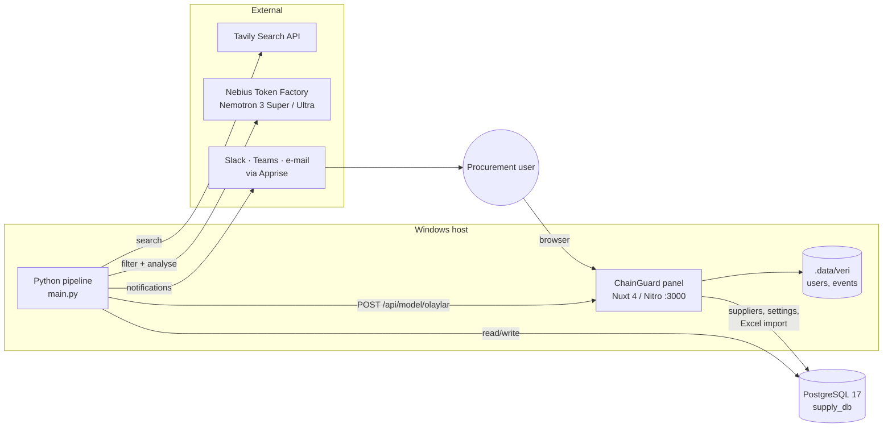

# SupplyChain Agent

Watches world news for events that hit a Turkish manufacturer's foreign suppliers — new customs duties
and taxes, trade restrictions, port and airport disruptions, component price swings — and turns them
into cost impacts, prioritised alerts and a web dashboard.

The example company is fictional: *KurguTek*, a desktop PC maker in Ankara (10,000 PCs/year) with nine
suppliers in China, Taiwan, Vietnam and South Korea.

**What a run does:**

1. Searches official, state-agency and trade-press sites with [Tavily](https://tavily.com), using queries generated from the supplier data.
2. An LLM agent (NVIDIA Nemotron 3 Super → Ultra on Nebius Token Factory) decides which articles matter and extracts rates, dates, delays and price changes.
3. Calculates the cost impact (Turkish customs GV, İGV, Kültür Fonu, ÖTV) and stock coverage per supplier part.
4. Groups the results into alerts that are tracked across scans (`new / changed / unchanged / resolved`).
5. Shows them on the **ChainGuard** panel and pushes important ones to Slack, Teams, e-mail and other channels.

## How we use NVIDIA Nemotron and Nebius Token Factory

The agent step runs on two NVIDIA Nemotron 3 models served by Nebius Token Factory, each sized for its job.

| Stage | Model (Token Factory id) | Job | Why this size |
|---|---|---|---|
| Filter | Nemotron 3 Super (`nvidia/nemotron-3-super-120b-a12b`) | Reads every article against the supplier list, one article per call. Decides if it is relevant and which suppliers it may affect. | High-volume step: must not miss a relevant article but must stay cheap. Caught every relevant article in our test set at about a third of Ultra's price per token. |
| Analysis | Nemotron 3 Ultra (`nvidia/Nemotron-3-Ultra-550b-a55b`) | Reads only the articles Super lets through. Checks Super's supplier list (removes wrong matches, adds missed ones) and extracts the facts the cost model needs: event type, tax type, old and new rates, effective date, delay in days, price change. | Accuracy matters most here: a wrong rate means a wrong cost. Most precise at matching suppliers and reading numbers across 8 languages. |

Both models return JSON that is validated against Pydantic schemas ([`agent_core/agent/schemas.py`](agent_core/agent/schemas.py)); an invalid answer is retried. The impact score (0–100) is computed in code from the model's facts ([`agent_core/agent/scoring.py`](agent_core/agent/scoring.py)), so the same facts always give the same score.

### How we chose the models

We ran Nemotron Nano, Lightning, Super and Ultra on the same 27-article test set (8 languages: Turkish, English, Chinese, Vietnamese, Korean, Japanese, Thai, Malay; 11 deliberate traps such as the wrong port, the same city but a different point, rumours and good news):

- Nano missed real alerts.
- Lightning did not return valid JSON for our schema.
- Super gave the best cost-to-recall balance for screening.
- Ultra gave the most accurate supplier matching and extraction.

**Result:** the Super + Ultra pipeline scored 27/27 on the test set, and a full run over 38 articles cost $0.23 (about $0.006 per article). The cost of each run is estimated from token counts and written to the results; a run with no new articles makes no model calls.

### Where Token Factory accelerated our workflow

- **One OpenAI-compatible API for every Nemotron model.** All model settings live in [`agent_core/agent/config.yaml`](agent_core/agent/config.yaml) (`base_url: https://api.tokenfactory.nebius.com/v1`). Comparing Nano, Lightning, Super and Ultra was a one-line change of `model_id`, which is how we picked our models in a few test runs instead of building separate integrations.
- **Standard OpenAI client.** [`agent_core/agent/llm_client.py`](agent_core/agent/llm_client.py) uses the regular `openai` Python package with the Token Factory URL, plus retries on invalid JSON and on rate limits.
- **Reasoning through the same API.** Both models run with Nemotron's thinking mode enabled in low-effort form (`enable_thinking: true`, `low_effort: true`), set per model in the config file.

The Token Factory key goes in `.env` as `NEBIUS_API_KEY` (see [Configuration](#configuration)). Details, test set and prompts: [agent_core/README.md](agent_core/README.md).

## Quick start

**For the jury:** a step-by-step guide for installing and trying the project on your own computer, including a
path that needs no API keys, is in **[docs/JURY_SETUP.md](docs/JURY_SETUP.md)**.

Panel login (created automatically on first start, local demo only):

| | |
|---|---|
| URL | http://localhost:3000 |
| E-mail | `yonetici@chainguard.test` |
| Password | `RCSP0v2Iwsk1H112R_e0` |

Prerequisites: **Docker Desktop**, **Python 3.11+**, **Node.js 22+**, and API keys for Tavily and Nebius Token Factory.

```bash
git clone https://github.com/nisabaysal07/SupplyChain_Agent.git
```

```bash
cd SupplyChain_Agent
```

**1. Configuration** — copy the root `.env.example` to `.env` and fill in `POSTGRES_PASSWORD`,
`TAVILY_API_KEY`, `NEBIUS_API_KEY`, `NUXT_MODEL_API_TOKEN` (≥ 32 characters) and the first-admin login.
Copy `kurulum/.env.example` to `kurulum/.env` with the same Postgres password.

**2. Database** — starts PostgreSQL 17 (and Qdrant) and loads the schema and seed data on first start:

```bash
docker compose -f kurulum/docker-compose.yml up -d
```

**3. Python pipeline:**

```bash
python -m venv .venv
```

```bash
.venv\Scripts\activate
```

```bash
pip install -r requirements.txt -r agent_core/requirements.txt
```

**4. Panel** (in a second terminal):

```bash
cd tedarikci_paneli/web && npm ci && npm run dev
```

Open http://localhost:3000 and sign in with `NUXT_ILK_YONETICI_EPOSTA` / `NUXT_ILK_YONETICI_SIFRE`.

**5. First scan:**

```bash
python main.py
```

New alerts appear on the panel's **Olaylar** page and in the notification bell.

Full setup notes in Turkish, including network sharing and database resets, are in [kurulum/KURULUM.md](kurulum/KURULUM.md).

## Configuration

All components read the single root `.env` (see [.env.example](.env.example)).

| Variable | Used by | Purpose |
|---|---|---|
| `POSTGRES_HOST`, `POSTGRES_PORT`, `POSTGRES_DB`, `POSTGRES_USER`, `POSTGRES_PASSWORD` | everything | `supply_db` connection |
| `TAVILY_API_KEY` | `main.py` | News search |
| `NEBIUS_API_KEY` | `agent_core` | Nemotron models; without it the agent step is skipped and articles wait for the next run |
| `NOTIFY_URLS` | `notify.py` | Comma-separated [Apprise](https://github.com/caronc/apprise/wiki) URLs (`slack://`, `mailto://`, `msteams://`, `windows://` …); empty = print only |
| `NOTIFY_MIN_SEVERITY` | `notify.py` | `high` (default), `medium` or `low` |
| `PANEL_URL` | `panel_sync.py`, `notify.py` | Panel address, default `http://localhost:3000` |
| `NUXT_MODEL_API_TOKEN` | panel + `panel_sync.py` | Shared secret for the model ingestion API; empty = API closed |
| `NUXT_SESSION_PASSWORD` | panel | Session cookie encryption key (≥ 32 characters) |
| `NUXT_ILK_YONETICI_EPOSTA`, `NUXT_ILK_YONETICI_SIFRE` | panel | First admin, created only when no user exists |
| `QDRANT_API_KEY` | Docker | Qdrant container (not used by the code yet) |

## Usage

### Full pipeline

```bash
python main.py               # scan → agent → cost impacts and alerts → panel → notifications
python main.py --no-agent    # scan only; the agent analyses the news on the next run
python main.py --schedule    # scheduled mode: skips if the panel's scan interval has not passed yet
```

### Scheduled scans (Windows Task Scheduler)

```powershell
.\kurulum\zamanlayici_kur.ps1          # install the hourly task
.\kurulum\zamanlayici_kur.ps1 -Kaldir  # remove it
```

The task wakes up every hour and scans only when the interval chosen in the panel
(**Ayarlar → Haber tarama sıklığı**: 1, 3, 6, 12 or 24 h, default 3 h) has passed. Output goes to `logs/tarama.log`.
`python Scheduler.py` does the same in an open terminal (for development).

### Individual steps

| Command | What it does |
|---|---|
| `python agent_core/data/build_suppliers.py` | Rebuild `suppliers.json` from the database after supplier data changes |
| `python query_planner.py` | Regenerate `search_plan.json` from the supplier list |
| `python -m agent --news data/examples/pc_test_news.json --dry-run` (in `agent_core/`) | Check the agent pipeline without API calls |
| `python -m agent --db --save` (in `agent_core/`) | Analyse every unanalysed article and store the results |
| `python risk_alerts.py [--scan N \| --replay]` | Refresh cost impacts and alerts for a scan |
| `python panel_sync.py [--dry-run \| --all]` | Push pending alerts to the panel |
| `python notify.py [--test \| --dry-run]` | Send pending notifications / test the channels |
| `python db/rebuild_db.py` | Back up, drop and rebuild `supply_db` from `db/` (asks for confirmation) |
| `python db/download_all.py` | Upsert the YAML reference data in `db/yaml/` |

### Panel

```bash
cd tedarikci_paneli/web
npm run dev            # development server on :3000
npm run ornek:gonder   # send sample events (server must be running)
npm test               # Vitest unit tests
npm run typecheck
```

End-to-end tests (Playwright + pytest), from `tedarikci_paneli/web`:

```bash
pip install -r e2e/requirements.txt && playwright install chromium && python -m pytest e2e
```

Admins can import company data (suppliers, parts, contracts, shipments, stock) from an `.xlsx` file on the
**Yükleme** page. Imports only add new records; they never change existing ones.

## Project structure

| Path | Contents |
|---|---|
| `main.py`, `Scheduler.py` | Orchestrator and development scheduler |
| `analyzer.py`, `sources.py`, `relevance.py`, `text_utils.py`, `config.py`, `models.py` | News scanner: Tavily search, source whitelist, relevance rules |
| `query_planner.py`, `search_plan.json` | Rule-based search query generation |
| `scan_log.py`, `article_store.py` | Scan records and article storage |
| `agent_core/` | LLM agent: prompts, schemas, scoring, Nebius client, test set ([README](agent_core/README.md)) |
| `maliyet_etkisi/` | Cost impact formula |
| `risk_alerts.py`, `panel_sync.py`, `notify.py` | Alerts, panel sync, external notifications |
| `db/` | Schema, seed data, YAML reference data and loaders |
| `kurulum/` | Docker Compose, DB init script, Task Scheduler installer, setup guide |
| `tedarikci_paneli/web/` | ChainGuard panel (Nuxt 4) — see [MODEL_ENTEGRASYONU.md](tedarikci_paneli/web/MODEL_ENTEGRASYONU.md) and [RISK_MODELI.md](tedarikci_paneli/web/RISK_MODELI.md) |
| `docs/ARCHITECTURE.md` | Full architecture document |

## Architecture

The system is a scheduled batch pipeline in Python plus a Nuxt web panel, joined by a PostgreSQL
database and an authenticated HTTP API. Everything runs on one Windows host, with Postgres in Docker.
Full details, the data model, design decisions and known gaps: **[docs/ARCHITECTURE.md](docs/ARCHITECTURE.md)**.



### Pipeline stages

| # | Stage | Module | Writes |
|---|---|---|---|
| 1 | Scan: run `search_plan.json` against whitelisted domains, rule-based pre-filter | `analyzer.py` | `scan_logs`, `articles` |
| 2 | Agent: Super filters every article, Ultra analyses the relevant ones, 0–100 score computed in code | `agent_core/agent` | `article_analyses`, `article_impacts` |
| 3 | Cost and alerts: cost/stock impact per analysis, grouped into alerts tracked across scans | `risk_alerts.py`, `maliyet_etkisi/` | `cost_impacts`, `alerts`, `alert_articles` |
| 4 | Panel sync: new/changed/resolved alerts become panel events | `panel_sync.py` | `alerts.panel_synced_at` |
| 5 | Notify: important new/changed alerts go to external channels | `notify.py` | `alerts.notified_at` |

Only stage 1 can fail a run. Stages 2–5 each catch their own errors and work from "pending" state in the
database, so anything missed is picked up on the next run, and re-running a scan changes nothing.

### Key design decisions

- **Cheap filter, expensive analyst.** Super screens every article and only relevant ones reach Ultra, so a run costs a few cents; see [How we use NVIDIA Nemotron and Nebius Token Factory](#how-we-use-nvidia-nemotron-and-nebius-token-factory).
- **Rules before the LLM.** Search queries come from the supplier data, and only official, state-agency and trade-press domains are searched. Results are reproducible and the model sees less noise.
- **The database connects the stages.** Each stage reads its own pending work from Postgres, so it can be re-run alone (`risk_alerts.py --scan N`, `panel_sync.py --all`).
- **The panel receives events by push.** The pipeline posts events to a token-protected API (`MODEL_ENTEGRASYONU.md`), which keeps the panel independent of any one model producer.
- **One host, batch runs.** The hourly Task Scheduler job plus the scan interval set in the panel is enough for one company and about 100 queries per scan.

## License

[Apache 2.0](LICENSE)
