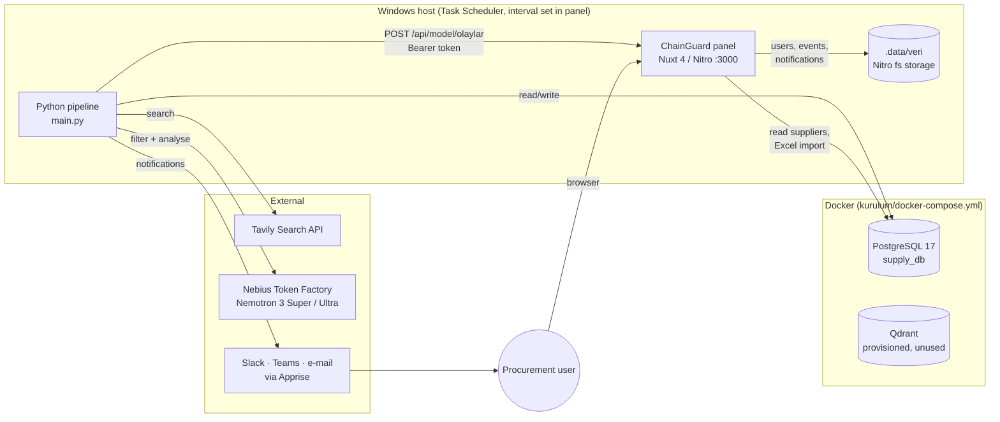
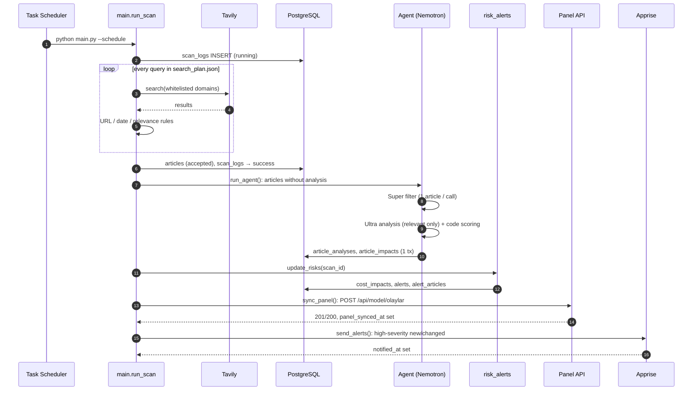
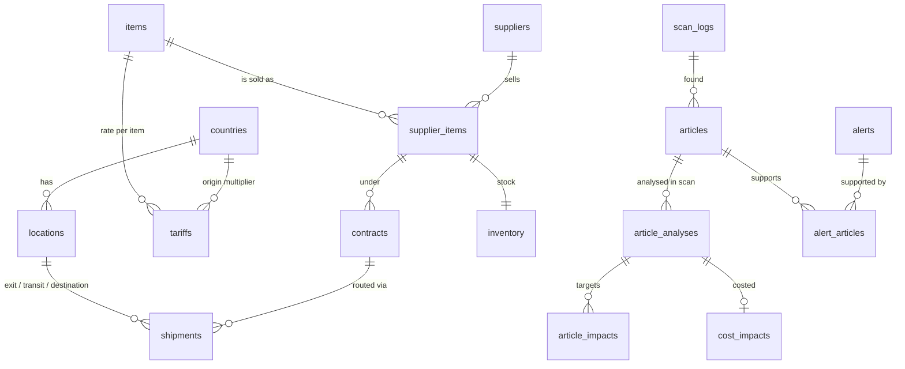

# SupplyChain Agent — Architecture

**Status:** Accepted (describes the system as built on branch `etki-arama-birlesim`)
**Date:** 2026-10-28

## 1. Purpose

A Turkish PC manufacturer (fictional *KurguTek*, Ankara, 10,000 PCs/year, nine single-source suppliers in
China, Taiwan, Vietnam and South Korea) needs to know, within hours, when world news affects its supply
chain: tariff and tax changes, trade restrictions, port/airport disruptions and component price swings.

The system:

1. searches whitelisted official and news sources for supplier-specific events,
2. has an LLM agent decide relevance and extract structured facts,
3. turns those facts into cost and stock impacts and de-duplicated alerts,
4. shows them on a web panel (ChainGuard) and pushes important ones to Slack / e-mail / Teams.

## 2. System context

## 3. Components

| Component | Path | Tech | Responsibility |
|---|---|---|---|
| Reference data loader | `db/` (`*_download.py`, `yaml/`, `data/*.sql`, `rebuild_db.py`) | Python, psycopg2, YAML | Schema (17 tables), seed data, idempotent YAML → DB upserts, backup-and-rebuild |
| Supplier snapshot | `agent_core/data/build_suppliers.py` → `suppliers.json` | Python | Denormalised supplier/part/route list that the planner and agent match against |
| Query planner | `query_planner.py` → `search_plan.json` | Python | Deterministic, rule-based search queries per supplier country, part, port/airport, in local languages |
| News scanner | `analyzer.py`, `sources.py`, `relevance.py`, `text_utils.py`, `config.py`, `models.py` | Python, Tavily | Runs the plan against whitelisted domains, validates URLs/dates, rule-based pre-filter, writes accepted news |
| Scan bookkeeping | `scan_log.py`, `article_store.py` | Python, psycopg2 | One `scan_logs` row per run (`running → success/failed`), articles linked to the scan |
| LLM agent | `agent_core/agent/` | Python, OpenAI SDK, Pydantic | Two-stage Nemotron pipeline (Super filter → Ultra analysis), deterministic 0–100 score, stores `article_analyses` / `article_impacts` |
| Cost impact engine | `maliyet_etkisi/maliyet_formulu.py` | Python | Unit / annual / per-PC cost delta from Turkish customs rules (GV, İGV, Kültür Fonu, ÖTV), stock-days and production-stop days |
| Alert engine | `risk_alerts.py` | Python, SQL | Upserts `cost_impacts`, groups analyses into risks (`event_type + target`), lifecycle `new / changed / unchanged / resolved`, severity and priority |
| Panel sync | `panel_sync.py` | Python, requests | Pushes pending alerts as panel events (`alarm-<id>`), marks `panel_synced_at` |
| External notifier | `notify.py` | Python, Apprise | Sends new/changed alerts ≥ `NOTIFY_MIN_SEVERITY` once, marks `notified_at` |
| Orchestrator | `main.py`, `Scheduler.py`, `kurulum/zamanlayici_kur.ps1` | Python, Windows Task Scheduler | Runs the chain; each downstream step isolated by try/except |
| ChainGuard panel | `tedarikci_paneli/web/` | Nuxt 4, Nitro, Nuxt UI, Tailwind 4, zod, pg, d3-geo | Dashboard, events, suppliers, settings, Excel upload, in-app notifications, model ingestion API, per-supplier 0–100 risk score |

## 4. Runtime flow (one scan)

Failure semantics: only the scan itself can fail the run (all queries erroring → `ScanFailed`).
The agent, alert refresh, panel sync and notifications each catch their own errors; their work is
driven by "pending" state in the DB (no analysis yet, `panel_synced_at IS NULL`, `notified_at IS NULL`),
so the next run picks up whatever was missed. Every step is idempotent for the same scan.

## 5. Data model

| Group | Tables | Written by |
|---|---|---|
| Reference / master | `countries`, `locations`, `rate_sources`, `items`, `tariffs`, `suppliers`, `supplier_items`, `contracts`, `shipments`, `inventory` | `db/` scripts, panel Excel import (insert-only) |
| News | `scan_logs`, `articles` | scanner |
| Agent output | `article_analyses`, `article_impacts` | agent (`agent/save.py`) |
| Risk output | `cost_impacts`, `alerts`, `alert_articles` | `risk_alerts.py` (flags set by `panel_sync.py`, `notify.py`) |
| Shared settings | `app_settings` (created on first save) | panel Ayarlar page; read by `main.py --schedule` / `Scheduler.py` |

Panel-only state (users with scrypt hashes, received events + model insights, notifications,
system settings) lives in Nitro `fs` storage under `tedarikci_paneli/web/.data/veri`, not in Postgres.

## 6. Key design decisions

### ADR-1: Two-tier LLM pipeline with deterministic scoring

| Option | Complexity | Cost / run | Accuracy (test set) |
|---|---|---|---|
| Ultra on every article | Low | High (~3× per token) | Best |
| **Super filter → Ultra on relevant only** (chosen) | Medium | A few cents | 27/27 synthetic, 3/3 + 10/10 real |
| Nano / Lightning filter | Medium | Lowest | Missed alerts / invalid JSON |

The impact score is computed in code from extracted facts (status band + size of event), so identical
facts always give identical scores and the LLM cannot drift the threshold. Ultra double-checks the
filter; disagreements are recorded as warnings. One article per filter call (batching dropped items).

### ADR-2: Rule-based search planning and source whitelisting before the LLM

Queries are generated deterministically from supplier data, and Tavily is restricted to official,
state-agency and trade-press domains per country. This keeps LLM cost proportional to plausible news,
makes results reproducible and auditable, and reduces prompt-injection and misinformation surface.
Trade-off: events reported only by non-whitelisted outlets are missed; adding a country means editing `config.py`.

### ADR-3: PostgreSQL as the integration point, state-driven retries

All Python stages communicate through tables rather than in-memory hand-offs. Each stage selects its
own pending work, so stages can be re-run individually (`python -m agent --db --save`,
`python risk_alerts.py --scan 9`, `python panel_sync.py --all`) and a crash in one never loses data.
Trade-off: correctness depends on the "pending" markers being cleared consistently (e.g. `risk_alerts.py`
must null `panel_synced_at` / `notified_at` on change).

### ADR-4: Panel as a push target with its own store

The pipeline pushes alerts to the panel over an authenticated HTTP API (`Bearer NUXT_MODEL_API_TOKEN`,
constant-time compare, 1 MB body limit, rate limit) instead of the panel reading `alerts` directly.
This keeps the panel usable with any model producer and its event contract (`MODEL_ENTEGRASYONU.md`)
explicit. Trade-off: events are duplicated (Postgres `alerts` + Nitro fs), and the panel computes its
own supplier risk score (`server/utils/risk.ts`) separate from the Python severity — see §8.

### ADR-5: Single-host, scheduled batch deployment

Everything runs on one Windows machine: Docker for Postgres/Qdrant, an hourly Task Scheduler job running
`main.py --schedule` (it scans only when the interval chosen in the panel, `app_settings.scan_interval_hours`,
default 3 h, has passed since the last successful scan), `npm run dev`/`preview` for the panel. Appropriate for a single-company prototype with
~100 queries per scan; no queue, worker pool or HA.

## 7. Cross-cutting concerns

- **Configuration / secrets:** one root `.env` shared by Python (`python-dotenv`) and Nuxt (`--dotenv ../../.env`): `TAVILY_API_KEY`, `NEBIUS_API_KEY`, `POSTGRES_*`, `NUXT_MODEL_API_TOKEN`, `NUXT_SESSION_PASSWORD`, `NOTIFY_URLS`. Secrets never reach `runtimeConfig.public`.
- **Panel security:** `nuxt-security` (CSP, rate limiter 150 / 5 min), `nuxt-auth-utils` encrypted httpOnly session (8 h), scrypt passwords, login lockout (`girisKilidi.ts`), admin-only routes (`yetki.ts`), body size limit middleware, trusted-IP header opt-in.
- **i18n:** panel in English and Turkish (`app/i18n`); agent summaries always English; source articles in 8+ languages.
- **Time zone:** "today" is Europe/Istanbul in the panel risk model.
- **Testing:** Vitest unit tests for panel server utils, Playwright + pytest e2e (isolated data dir, random admin), agent dry-run mode and a 27-article answer-keyed test set.
- **Observability:** `scan_logs` counts, agent cost estimate per run, JSON outputs per run (`agent_core/output/`, `rejected_results_debug.json`), console logs. No metrics/alerting on pipeline health itself.

## 8. Known gaps and recommended next steps

| # | Issue | Impact | Recommendation |
|---|---|---|---|
| 1 | Two risk models: Python `severity`/`priority_score` (`risk_alerts.py`) and panel 0–100 supplier score (`risk.ts`) map severity differently | Users can see conflicting "how bad is it" signals | Make the panel display the Python alert severity as-is and keep `risk.ts` only for the supplier composite score; document the mapping in one place |
| 2 | Company constants duplicated (`YILLIK_PC = 10_000` in `maliyet_formulu.py`, `YILLIK_URETIM` + half-production parts in `veri.ts`, `sirket.md`) | Silent divergence when production changes | Move to a `company_settings` table or a single config file read by both |
| 3 | Panel events/users in Nitro fs storage | No backup with `pg_dump`, not multi-instance safe, event history split from `alerts` | Move panel tables into `supply_db` (separate schema) |
| 4 | Qdrant is provisioned but unused | Extra container, API key to manage | Remove from compose until semantic de-duplication / RAG is actually built |
| 5 | `build_suppliers.py` exists both at root and in `agent_core/data/`; `suppliers.json` and `search_plan.json` are generated snapshots | Stale snapshot → queries/matching miss newly imported suppliers | Keep one script; regenerate both files at the start of `run_scan` |
| 6 | `Scheduler.py` (dev loop) and Task Scheduler can both be running | Double scans if both are active on one machine | Document `Scheduler.py` as dev-only; guard with the `scan_logs` "running" row |
| 7 | No pipeline health monitoring | A silently failing scan (bad API key) is only visible in logs | Notify via Apprise when `scan_logs.status = 'failed'` or no successful scan in 6 h |
| 8 | Panel runs via `nuxt dev`/`preview` on the host | Not hardened for production | Build (`nuxt build`) and run the Node output behind a reverse proxy, or containerise alongside Postgres |
